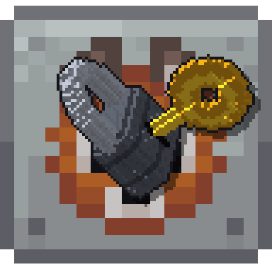

# ModLock

**English** | [Português (Brasil)](README.pt-BR.md)

A NeoForge mod that restricts **hand crafting** of items per mod, per player. Built for progression
modpacks and interactive series: each player can only hand-craft items from the mods they unlocked.
Machines and automation are never restricted.

## Downloads
Grab the jar for your Minecraft version from [Releases](https://github.com/mzramna/modlock/releases/latest):

| Jar                        | Minecraft | NeoForge | Packs |
|----------------------------|-----------|----------|-------|
| `modlock-1.21.1-<ver>.jar` | 1.21.1    | 21.1.x   | ATM10, ATM10 To The Sky, ATM10 Aeronautics, All the Mons |
| `modlock-26.1.2-<ver>.jar` | 26.1.2    | 26.1.x   | ATM11 |

Install it on **both server and clients**.

## Features (stage 1)
- **Crafting table and 2x2 grid:** the result does not appear if the player has no access to the item's mod; a red preview explains why.
- **Smithing table and stonecutter:** same rule.
- **Furnace, blast furnace, smoker:** they accept the item but do not cook when the player who **put it in by hand** has no access. Hoppers and automation always work.
- **Other mods' machines:** a player cannot put an item in by hand when **every** single-ingredient recipe for it produces something locked. If any recipe produces something allowed, the item is accepted. Pipes and hoppers are never checked.
- **Optional strict mode** (off by default): also blocks using, placing and opening blocks, items and entities of locked mods.
- `always_allowed` / `manual_only` lists by recipe id or `item:<id>`.
- Lock tooltips (also in JEI/EMI), English and Brazilian Portuguese translations.

## Configuration
File `serverconfig/modlock-server.toml` in the world (or `defaultconfigs/` in a modpack).

| Option | Description |
|--------|-------------|
| `locked_mods` | Mods controlled by ModLock. `["*"]` locks every mod except `minecraft` and `global_allowed_mods`. |
| `global_allowed_mods` | Always allowed for everyone. |
| `always_allowed` / `manual_only` | Per-recipe exceptions. |
| `smelting_enabled`, `smithing_and_stonecutter` | Vanilla stations. |
| `block_manual_insert`, `insert_exempt_blocks` | Machine rule and storage blocks it ignores (also tag `#modlock:insert_exempt`). |
| `block_usage_of_locked_mods` | Strict mode. |

## Commands (OP level 2)
```
/modlock grant|revoke <players> mod <modid>
/modlock grant|revoke <players> item <item>
/modlock grant|revoke <players> machine <block>
/modlock list [player]
/modlock reload
```

## Roadmap
Initial mod choice on first join and exclusivity → Mod Key → temporary knowledge effects → Recipe Scroll, Tomes and Machine License → JEI/EMI polish.

## Building
| Branch   | Java |
|----------|------|
| `1.21.1` | 21   |
| `26.1`   | 25   |

```bash
./gradlew build              # jar in build/libs
./gradlew runGameTestServer  # automated GameTests
```

CI runs build + GameTests on every push and pull request. Pushing a `v*` tag (e.g. `v0.1.0`) builds and tests both branches and publishes one release with both jars.

## License
[MIT](LICENSE)
