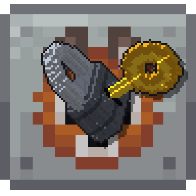
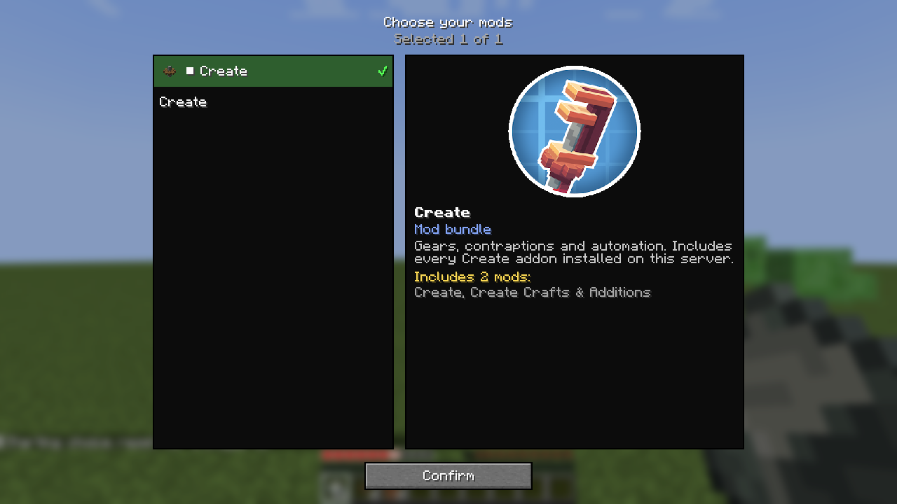
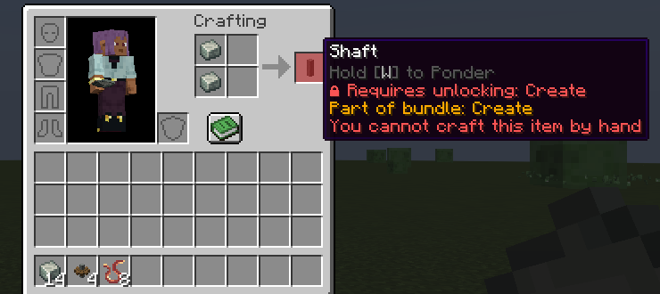
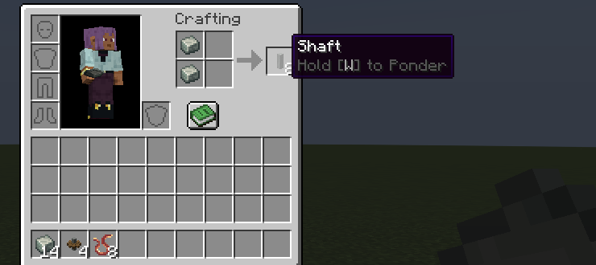
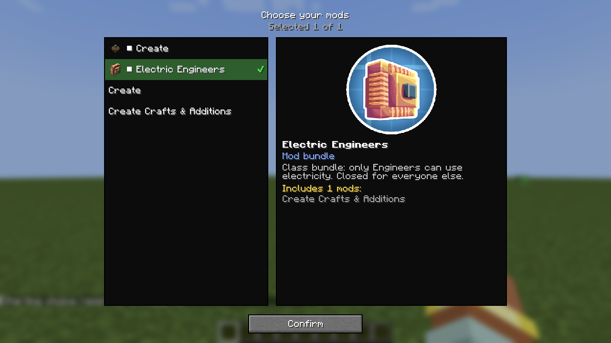
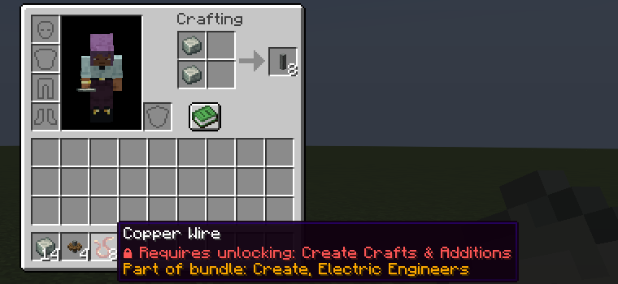
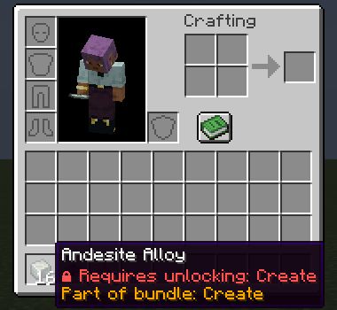
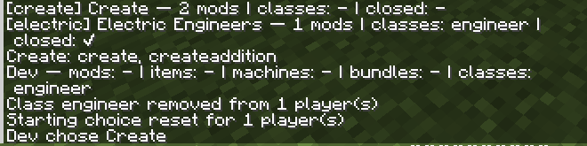

<div align="center">



# ModLock

**Unlock mods as you play.**
Lock hand crafting per mod and per player, then let players earn mods, or whole mod bundles with all their addons, over time.

**English** | [Português (Brasil)](README.pt-BR.md)

[](https://github.com/mzramna/modlock/releases/latest)


[](https://github.com/mzramna/modlock/actions)
[](LICENSE)

</div>

<p align="center">
  
</p>

## Why ModLock?

- 🧭 **Progression modpacks:** start with a few mods and unlock the rest through quests, loot or admin rewards.
- 🎬 **Interactive series and YouTube:** "Player A owns Create, Player B owns Mekanism" becomes a game rule instead of a gentlemen's agreement.
- 🛡️ **RP servers with classes:** give each class its own closed bundle of mods (engineers get electricity, mages get magic…).
- ⚙️ **Light by design:** only *hand crafting* is restricted. Machines, automation and hoppers keep working, so other mods run untouched and fast.

## Gallery

| Locked craft | Unlocked after choosing |
|:---:|:---:|
|  |  |
| The result does not appear: a red ghost explains why. | Pick the bundle and the recipe just works. |

| Bundle restricted to a class | Closed bundles win |
|:---:|:---:|
|  |  |
| Only *Engineers* see the **Electric Engineers** bundle. | An addon in a closed class bundle stays locked for other classes, even inside the Create bundle. |

| Lock tooltip | Commands |
|:---:|:---:|
|  |  |

## Features

- 🔒 **Per-mod crafting lock**: crafting table, 2x2 grid, smithing table and stonecutter.
- 🔥 **Furnaces**: they accept anything, but won't cook for a player who put the item in by hand without access. Hoppers always work.
- 🏭 **Machines of other mods**: a player can't hand-insert an item whose every recipe gives something they can't craft.
- 📦 **Mod bundles**: one JSON file unlocks a mod **plus every installed addon of it**, detected automatically from the dependencies.
- 🎭 **RP classes**: restricted and **closed** bundles. Give classes by command or by the tag `modlock.class.<class>`.
- 🖼️ **Starting choice screen**: players pick bundles or single mods on first join, with picture, description and the list of mods. Optional exclusivity ("already taken by…").
- ✅ **Exceptions**: `always_allowed` and `manual_only` per recipe or item, plus an optional strict mode that also blocks using and placing blocks of locked mods.
- 🌍 **Translated**: English and Brazilian Portuguese. Every message is translated on the client.

## Quick start

1. Download the jar for your Minecraft version from **[Releases](https://github.com/mzramna/modlock/releases/latest)** and install it **on the server and on every client**.
2. In `config/modlock-server.toml`, lock some mods: `locked_mods = ["create", "mekanism"]` (or `["*"]` for everything).
3. Optional: create a bundle in `config/modlock/bundles/create.json` and give it with `/modlock grant <player> bundle create`, or turn on `show_selection_screen` so players pick it themselves.

| Minecraft | NeoForge | Java | Modpacks |
|---|---|---|---|
| 1.21.1 | 21.1+ | 21 | ATM10, ATM10 To The Sky, ATM10 Aeronautics, All the Mons |
| 26.1.2 | 26.1+ | 25 | ATM11 |

Modrinth and CurseForge pages are coming soon.

## Mod bundles

One file per bundle in `config/modlock/bundles/<id>.json` (a commented example, `_example.json.txt`, is generated there):

```jsonc
{
  "name": "Create",                 // required
  "icon": "create:cogwheel",        // optional: item icon
  "image": "create.png",            // optional: picture for the choice screen (PNG next to this file, up to 256 KiB,
                                    //           or a resource pack texture like "mypack:textures/gui/create.png")
  "description": "Create and its addons",
  "mods": ["create"],               // base mods
  "include_addons": true,           // + every installed mod with a REQUIRED dependency on a member (recursive)
  "include": [], "exclude": [],
  "classes": [],                    // RP: only players with one of these classes can use it
  "closed": false                   // members are denied to everyone outside "classes", whatever else they unlocked
}
```

Addons are resolved when the server starts or on `/modlock reload`, so new addons join automatically. With `lock_bundle_members = true` (the default), addons are locked whenever the bundle's base mod is locked.

## Configuration

`serverconfig/modlock-server.toml` in the world (or `defaultconfigs/` in a modpack).

| Option | What it does |
|---|---|
| `locked_mods` / `global_allowed_mods` | Mods controlled by ModLock / always free. `["*"]` locks everything except `minecraft`. |
| `always_allowed` / `manual_only` | Per-recipe exceptions (recipe id or `item:<id>`). |
| `smelting_enabled`, `smithing_and_stonecutter` | Vanilla stations. |
| `block_manual_insert`, `insert_exempt_blocks` | Machine rule and the storage blocks it ignores (also the tag `#modlock:insert_exempt`). |
| `block_usage_of_locked_mods` | Strict mode: no using, placing or opening locked mods' blocks and items. |
| `starting_count`, `show_selection_screen`, `allow_single_mods`, `choosable_mods`, `exclusive`, `announce_choice` | Starting choice. |
| `lock_bundle_members` | Lock the addons of locked bundle bases. |
| `block_modlock_crafting` | Nobody can craft ModLock items, not even automation. |
| `loot.enabled`, `loot.tome_bundles` | Unlock items in loot chests (they take effect once the tomes ship). |

## Commands

```
/modlock grant|revoke <players> mod|item|machine|bundle <id>
/modlock class add|remove <players> <class>
/modlock bundles [id]
/modlock resetchoice <players>
/modlock list [player]
/modlock reload
```
Any player can use `/modlock choose` to reopen the choice screen until they confirm.

## FAQ

**Does it block machines and automation?** No. Only crafting done by hand is checked. A hopper feeding a furnace, an AE2 autocrafter or a Create mechanical crafter keep working. This is on purpose: it keeps the mod light and compatible.

**Do I need it on the client?** Yes. The choice screen, lock tooltips and the red preview are client-side.

**Can I use it with KubeJS or quest mods?** Yes. Classes can be given with the tag `modlock.class.<class>`, and everything else with the `/modlock` commands.

## Roadmap

Mod Key (quest reward) → temporary knowledge effects → Recipe Scroll, Tomes and Machine License → JEI/EMI polish.

## Building

| Branch | Minecraft | Java |
|---|---|---|
| `1.21.1` | 1.21.1 | 21 |
| `26.1` | 26.1.2 | 25 |

```bash
./gradlew build              # jar in build/libs
./gradlew runGameTestServer  # automated GameTests
```

CI runs build and GameTests on every push and pull request. Pushing a `v*` tag, or pushing to the `release` branch (the tag `v<mod_version>` is created automatically), builds and tests both branches and publishes one release with one jar per Minecraft version.

## License

[MIT](LICENSE)
