<div align="center">


# ModLock

**Libere mods jogando.**
Bloqueie o craft manual por mod e por jogador, e deixe os jogadores conquistarem mods, ou pacotes inteiros de mods com todos os addons, ao longo do tempo.

[English](README.md) | **Português (Brasil)**

[](https://github.com/mzramna/modlock/releases/latest)


[](https://github.com/mzramna/modlock/actions)
[](LICENSE)

</div>

<p align="center">
  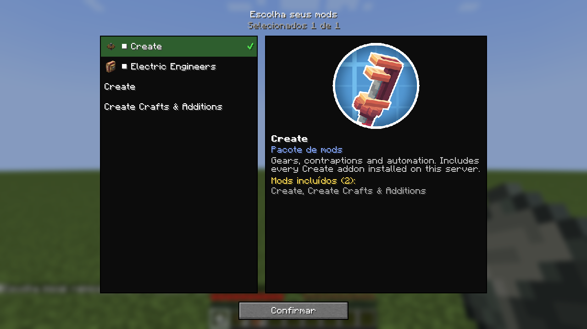
</p>

## Por que usar o ModLock?

- 🧭 **Modpacks de progressão:** comece com poucos mods e libere o resto com quests, loot ou recompensas dos admins.
- 🎬 **Séries de interação e YouTube:** "Fulano é dono do Create, Ciclano do Mekanism" vira regra do jogo, não acordo de cavalheiros.
- 🛡️ **Servidores RP com classes:** cada classe tem seu próprio pacote fechado de mods (engenheiros ficam com a eletricidade, magos com a magia…).
- ⚙️ **Leve de propósito:** só o *craft manual* é restringido. Máquinas, automação e funis continuam funcionando, então os outros mods rodam intactos e rápidos.

## Galeria

| Craft bloqueado | Liberado depois da escolha |
|:---:|:---:|
| 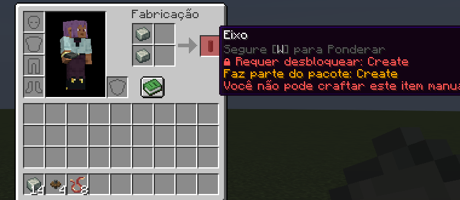 |  |
| O resultado não aparece: um fantasma vermelho explica o motivo. | Escolhendo o pacote, a receita funciona. |

| Pacote restrito a uma classe | Pacote fechado tem prioridade |
|:---:|:---:|
|  |  |
| Só *Engenheiros* veem o pacote **Electric Engineers**. | Um addon de um pacote fechado de classe continua bloqueado pras outras classes, mesmo dentro do pacote Create. |

| Tooltip de cadeado | Comandos |
|:---:|:---:|
|  |  |

## Funcionalidades

- 🔒 **Bloqueio de craft por mod**: mesa de craft, grade 2x2, mesa de ferraria e cortador de pedras.
- 🔥 **Fornalhas**: aceitam qualquer item, mas não cozinham se quem colocou à mão não tem acesso. Funis sempre funcionam.
- 🏭 **Máquinas de outros mods**: o jogador não consegue colocar à mão um item cujas receitas só geram coisas que ele não pode craftar.
- 📦 **Pacotes de mods**: um arquivo JSON libera um mod **e todos os addons dele instalados**, detectados sozinhos pelas dependências.
- 🎭 **Classes de RP**: pacotes restritos e **fechados**. Dê classes por comando ou pela tag `modlock.class.<classe>`.
- 🖼️ **Tela de escolha inicial**: o jogador escolhe pacotes ou mods avulsos no primeiro login, com imagem, descrição e lista de mods. Exclusividade opcional ("já escolhido por…").
- ✅ **Exceções**: `always_allowed` e `manual_only` por receita ou item, e um modo estrito opcional que também bloqueia usar e colocar blocos de mods bloqueados.
- 🌍 **Traduzido**: inglês e português do Brasil. Toda mensagem é traduzida no cliente.

## Começo rápido

1. Baixe o jar da sua versão do Minecraft em **[Releases](https://github.com/mzramna/modlock/releases/latest)** e instale **no servidor e em todos os clientes**.
2. Em `config/modlock-server.toml`, bloqueie alguns mods: `locked_mods = ["create", "mekanism"]` (ou `["*"]` pra todos).
3. Opcional: crie um pacote em `config/modlock/bundles/create.json` e dê com `/modlock grant <jogador> bundle create`, ou ligue `show_selection_screen` pra que os jogadores escolham.

| Minecraft | NeoForge | Java | Modpacks |
|---|---|---|---|
| 1.21.1 | 21.1.145+ | 21 | ATM10, ATM10 To The Sky, ATM10 Aeronautics, All the Mons |
| 26.1.2 | 26.1+ | 25 | ATM11 |

Páginas no Modrinth e no CurseForge em breve.

## Pacotes de mods

Um arquivo por pacote em `config/modlock/bundles/<id>.json` (um exemplo comentado, `_example.json.txt`, é gerado lá):

```jsonc
{
  "name": "Create",                 // obrigatório
  "icon": "create:cogwheel",        // opcional: item usado como ícone
  "image": "create.png",            // opcional: imagem da tela de escolha (PNG ao lado deste arquivo, até 256 KiB,
                                    //           ou textura de resource pack, ex. "meupack:textures/gui/create.png")
  "description": "Create e seus addons",
  "mods": ["create"],               // mods base
  "include_addons": true,           // + todo mod instalado com dependência OBRIGATÓRIA em um membro (recursivo)
  "include": [], "exclude": [],
  "classes": [],                    // RP: só jogadores com uma dessas classes podem usar
  "closed": false                   // membros são negados a quem está fora de "classes", mesmo que liberados de outro jeito
}
```

Os addons são resolvidos quando o servidor inicia ou com `/modlock reload`, então addons novos entram sozinhos. Com `lock_bundle_members = true` (padrão), os addons ficam bloqueados sempre que o mod base do pacote está bloqueado.

## Configuração

`serverconfig/modlock-server.toml` do mundo (ou `defaultconfigs/` no modpack).

| Opção | O que faz |
|---|---|
| `locked_mods` / `global_allowed_mods` | Mods controlados pelo ModLock / sempre liberados. `["*"]` bloqueia tudo exceto `minecraft`. |
| `always_allowed` / `manual_only` | Exceções por receita (ID da receita ou `item:<id>`). |
| `smelting_enabled`, `smithing_and_stonecutter` | Estações vanilla. |
| `block_manual_insert`, `insert_exempt_blocks` | Regra de máquinas e blocos de armazenamento ignorados (também a tag `#modlock:insert_exempt`). |
| `block_usage_of_locked_mods` | Modo estrito: sem usar, colocar ou abrir blocos e itens de mods bloqueados. |
| `starting_count`, `show_selection_screen`, `allow_single_mods`, `choosable_mods`, `exclusive`, `announce_choice` | Escolha inicial. |
| `lock_bundle_members` | Bloqueia os addons de pacotes com mod base bloqueado. |
| `block_modlock_crafting` | Ninguém pode craftar itens do ModLock, nem a automação. |
| `loot.enabled`, `loot.chance`, `loot.tome_bundles` | Tomos Puros nos baús de loot (opcionalmente só tomos ligados a esses pacotes). |

## Itens e efeitos

| | Item | O que faz | Como conseguir |
|:---:|---|---|---|
|  | **Chave de Mod** | Libera mods ou pacotes **de vez**. Configurada por um OP: TODOS da lista, ESCOLHER N ou SORTEAR N. | Sem receita: criativo, `/modlock give`, recompensa de quest |
| 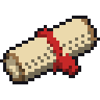 | **Pergaminho de Receita** | Ensina **um item** — pra sempre ou por um tempo (efeito `Receita: <item>`). Jogadores podem vender receitas dos mods que possuem. | Receita barata |
| 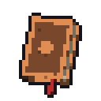 | **Tomo Mundano** | **Empresta um mod inteiro** por até 9 h (efeito `Conhecimento: <mod>`). Escrito pelo dono do mod ou por um OP. | Receita cara (estrela do Nether) |
| 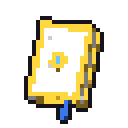 | **Tomo Puro** | Conhecimento de **qualquer mod que você escolher** (ou de um pacote pré-definido) por até 9 h. | Só em baús de loot (ou criativo) |
| 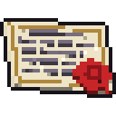 | **Licença de Máquina** | Deixa usar e alimentar à mão **uma máquina** de um mod que você não tem — pra sempre ou por um tempo. | Receita moderada |

<p align="center">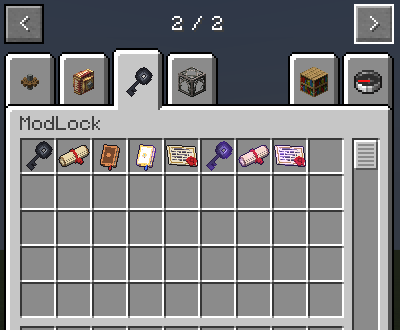</p>

| Configurando uma Chave de Mod | Resgatando (ESCOLHER) |
|:---:|:---:|
| 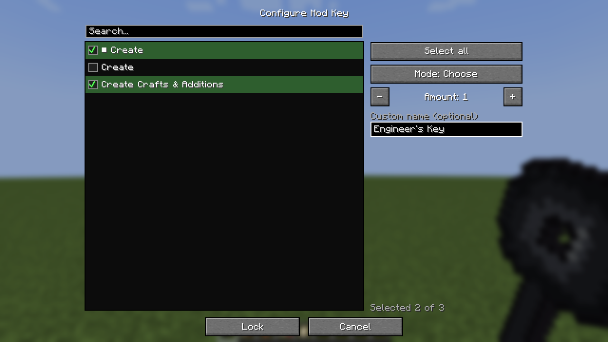 | 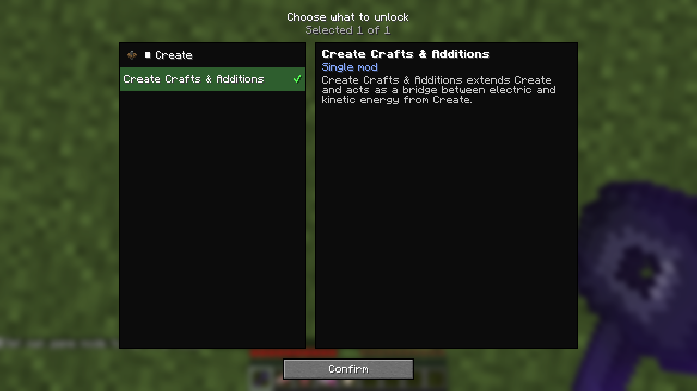 |

| Pergaminho de Receita | Tomo Mundano | Licença de Máquina |
|:---:|:---:|:---:|
| 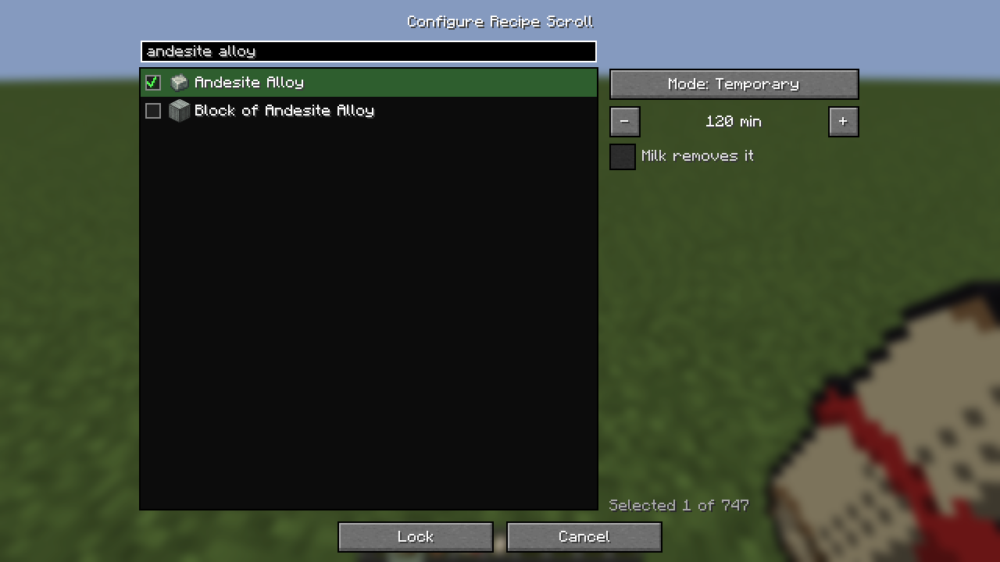 | 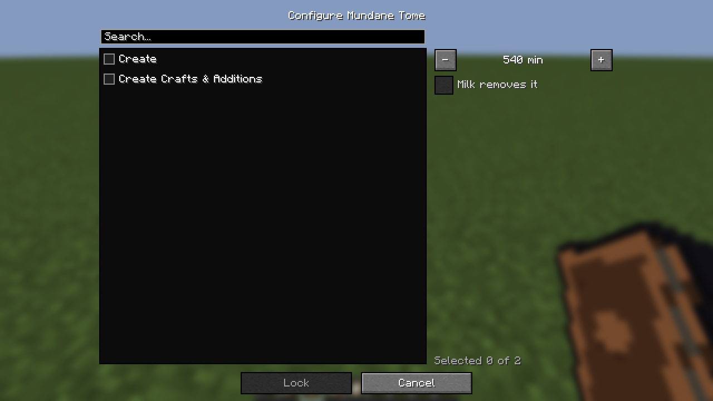 | 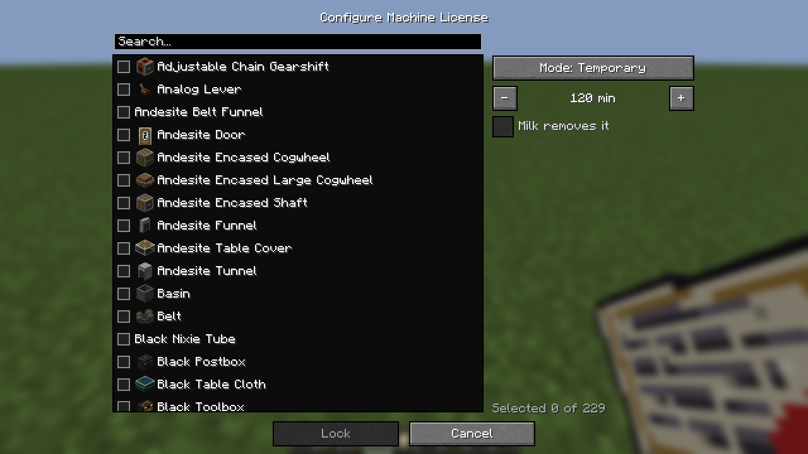 |
| 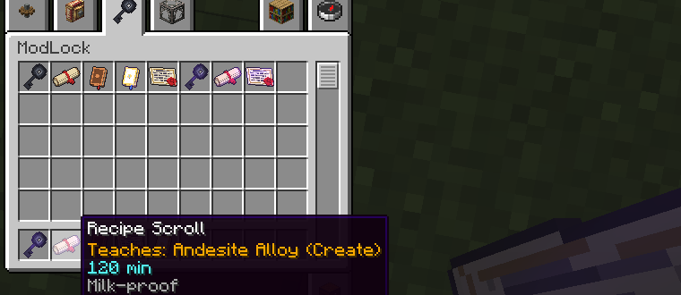 | 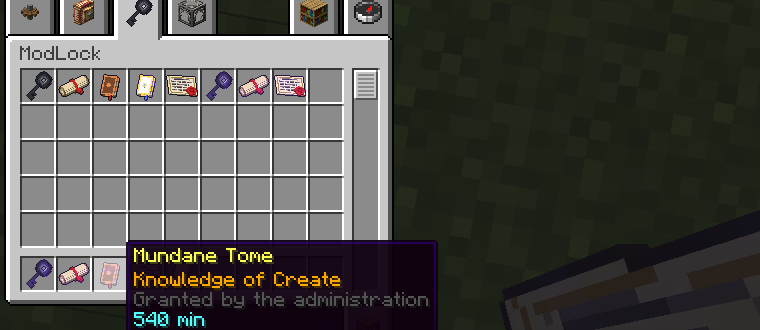 | 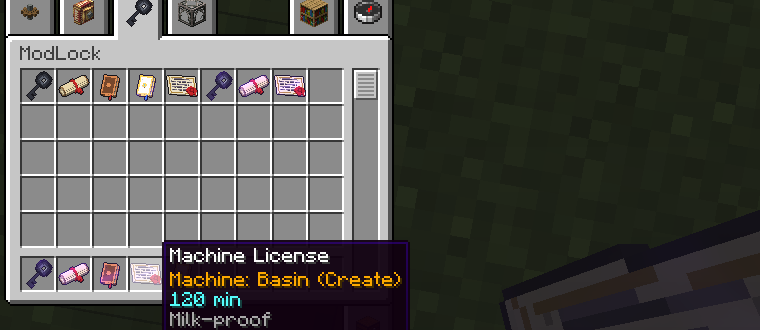 |

| Efeitos no inventário | Detalhes do efeito | HUD |
|:---:|:---:|:---:|
| 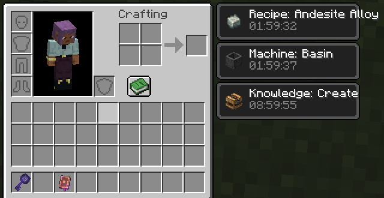 | 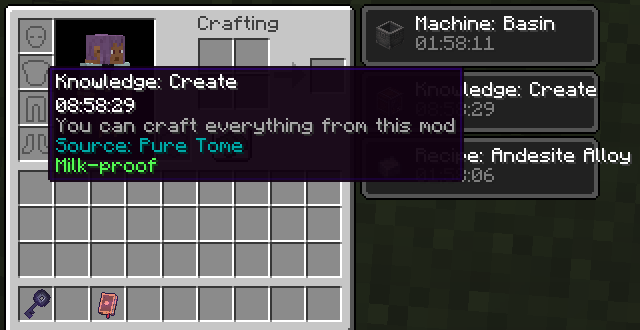 | 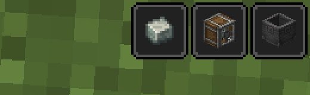 |

### Detalhes

| Item | Configurar (primeiro uso) | Usar |
|---|---|---|
| **Chave de Mod** | OPs (`[mod_key] config_permission_level`) ou jogadores no criativo escolhem mods e pacotes bloqueados (`bundle:<id>`), uma quantidade, um modo (**ALL** / **CHOOSE** / **RANDOM**) e um nome opcional, e clicam em **Travar**. Os outros jogadores só recebem uma mensagem. OPs podem agachar + usar pra reconfigurar. | Libera de vez o que o jogador ainda não tem (menos mods livres e, com `exclusive`, o que já é de outro). ALL = tudo, RANDOM = N ao acaso, CHOOSE = tela de escolha. Só é gasta depois de liberar algo; se não sobrar nada, não é gasta. |
| **Pergaminho de Receita** | OPs: qualquer item de mod bloqueado. Jogadores: só itens de mods bloqueados que eles conseguem craftar agora (pergaminhos permanentes exigem acesso permanente). Lista de itens com busca, PERMANENTE / TEMPORÁRIO, minutos, caixa do leite. | Permanente: o item fica liberado de vez. Temporário: efeito `Receita: <item>`. |
| **Tomo Mundano** | Jogadores: só mods que têm **permanentemente**. OPs: qualquer mod bloqueado (e uma duração menor). | Empresta o mod: efeito `Conhecimento: <mod>` por `duration_minutes` (540). Quem escreveu não pode ler (`allow_self_use`). |
| **Tomo Puro** | Nada a configurar; pode estar ligado a um pacote. | Sem pacote: escolha qualquer mod bloqueado que você não tem. Com pacote: conhecimento de todos os membros do pacote (se sua classe puder usá-lo). Opcionalmente permanente. |
| **Licença de Máquina** | OPs: qualquer bloco com block entity de mod bloqueado. Jogadores: máquinas de mods que têm permanentemente. PERMANENTE / TEMPORÁRIO como o pergaminho. | Deixa o jogador colocar itens à mão naquela máquina (e usá-la no modo estrito). |

O **conhecimento temporário** são efeitos de verdade: `modlock:knowledge/<mod>` pra cada mod, e `modlock:recipe/<mod>/<item>` / `modlock:machine/<mod>/<bloco>` pros mods de `config/modlock-startup.toml` (`recipe_effect_mods = ["*"]`, mantenha igual no servidor e nos clientes). O ícone é o item ou o primeiro item do mod, e o tooltip no inventário mostra a origem, o tempo restante e se o leite remove. O jogador recebe um aviso na action bar antes de acabar, e `/modlock knowledge` lista os efeitos. Jogadores offline não têm efeitos, então o conhecimento temporário não conta pra eles.

| Opção | O que faz |
|---|---|
| `[items] op_permission_level` | Quem conta como OP para pergaminhos, tomos e licenças (criativo sempre conta). |
| `[mod_key] config_permission_level`, `allow_op_reconfigure`, `announce_redeem` | Chave de Mod. |
| `[recipe_scroll] max_temporary_minutes`, `allow_permanent_by_non_op`, `blacklist_items`, `restricted_mods`, `ops_bypass_restrictions` | Pergaminho de Receita. |
| `[mundane_tome] duration_minutes`, `op_can_set_duration`, `restriction_mode`, `restricted_mods`, `ops_bypass_restrictions`, `allow_self_use`, `op_tooltip_text` | Tomo Mundano. |
| `[pure_tome] duration_minutes`, `permanent`, `restriction_mode`, `restricted_mods`, `respect_exclusivity` | Tomo Puro. |
| `[machine_license] max_temporary_minutes`, `allow_permanent_by_non_op` | Licença de Máquina. |
| `[temporary_knowledge] stack_mode` (MAX/ADD), `max_minutes`, `warn_before_expire_seconds` | Usar outro item pro mesmo conhecimento: fica o tempo maior ou soma. Itens que não aumentariam o tempo não são gastos. |
| `[temporary_knowledge.milk] mode` (PER_ITEM/ALWAYS/NEVER), `default_curable`, `unconfigured_curable`, `players_can_choose` | O leite remove o conhecimento? |
| `config/modlock-startup.toml`: `recipe_effect_mods`, `include_minecraft` | Quais mods ganham efeitos por item / por máquina. |

## Comandos

```
/modlock grant|revoke <jogadores> mod|item|machine|bundle <id>
/modlock class add|remove <jogadores> <classe>
/modlock bundles [id]
/modlock resetchoice <jogadores>
/modlock list [jogador]
/modlock reload
/modlock give <jogadores> key <ALL|CHOOSE|RANDOM> <quantidade> <mod,bundle:id,...>
/modlock give <jogadores> pure_tome [pacote]
/modlock knowledge [jogador]
/modlock knowledge clear <jogador> [efeito]
```
Qualquer jogador pode usar `/modlock choose` pra reabrir a tela de escolha enquanto não confirmar, e `/modlock knowledge` pra ver o próprio conhecimento temporário.

## Perguntas frequentes

**Bloqueia máquinas e automação?** Não. Só o craft feito à mão é checado. Um funil abastecendo a fornalha, um autocrafter do AE2 ou um mechanical crafter do Create continuam funcionando. É de propósito: deixa o mod leve e compatível.

**Precisa estar no cliente?** Sim. A tela de escolha, os tooltips de cadeado e a prévia vermelha rodam no cliente.

**Funciona com KubeJS ou mods de quest?** Sim. Classes podem ser dadas pela tag `modlock.class.<classe>`, e o resto pelos comandos `/modlock`.

## Próximas etapas

Acabamento com JEI/EMI.

## Compilando

| Branch | Minecraft | Java |
|---|---|---|
| `1.21.1` | 1.21.1 | 21 |
| `26.1` | 26.1.2 | 25 |

```bash
./gradlew build              # jar em build/libs
./gradlew runGameTestServer  # GameTests automatizados
```

O CI roda build e GameTests em todo push e pull request. Enviar uma tag `v*`, ou fazer push no branch `release` (a tag `v<mod_version>` é criada automaticamente), compila e testa os dois branches e publica um release com um jar por versão do Minecraft.

## Licença

[MIT](LICENSE)
