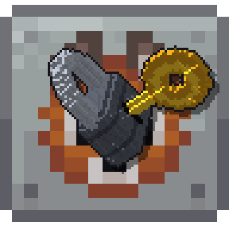

# ModLock

[English](README.md) | **Português (Brasil)**

Mod para NeoForge que restringe o **craft manual** de itens por mod, por jogador. É pensado para
modpacks de progressão e séries de interação: cada jogador só crafta à mão os itens dos mods que liberou.
Máquinas e automação nunca são restringidas.

## Downloads
Baixe o jar da sua versão do Minecraft em [Releases](https://github.com/mzramna/modlock/releases/latest):

| Jar                        | Minecraft | NeoForge | Packs |
|----------------------------|-----------|----------|-------|
| `modlock-1.21.1-<ver>.jar` | 1.21.1    | 21.1.x   | ATM10, ATM10 To The Sky, ATM10 Aeronautics, All the Mons |
| `modlock-26.1.2-<ver>.jar` | 26.1.2    | 26.1.x   | ATM11 |

Instale **no servidor e nos clientes**.

## Funcionalidades (etapa 1)
- **Mesa de craft e grade 2x2:** o resultado não aparece se o jogador não tem acesso ao mod do item; uma prévia vermelha mostra o motivo.
- **Mesa de ferraria e cortador de pedras:** mesma regra.
- **Fornalha, alto-forno e defumador:** aceitam o item, mas não cozinham se **quem colocou à mão** não tem acesso. Funil e automação sempre funcionam.
- **Máquinas de outros mods:** o jogador não consegue colocar à mão um item quando **todas** as receitas de ingrediente único dele geram algo bloqueado. Se alguma receita gera algo permitido, o item é aceito. Canos e funis nunca são checados.
- **Modo estrito opcional** (desligado por padrão): também bloqueia usar, colocar e abrir blocos, itens e entidades de mods bloqueados.
- Listas `always_allowed` / `manual_only` por ID de receita ou `item:<id>`.
- Tooltips de cadeado (inclusive no JEI/EMI), traduções em inglês e português.

## Configuração
Arquivo `serverconfig/modlock-server.toml` do mundo (ou `defaultconfigs/` no modpack).

| Opção | Descrição |
|-------|-----------|
| `locked_mods` | Mods controlados pelo ModLock. `["*"]` bloqueia todos os mods, exceto `minecraft` e os de `global_allowed_mods`. |
| `global_allowed_mods` | Sempre liberados para todos. |
| `always_allowed` / `manual_only` | Exceções por receita. |
| `smelting_enabled`, `smithing_and_stonecutter` | Estações vanilla. |
| `block_manual_insert`, `insert_exempt_blocks` | Regra de máquinas e blocos de armazenamento ignorados (também a tag `#modlock:insert_exempt`). |
| `block_usage_of_locked_mods` | Modo estrito. |

## Comandos (OP nível 2)
```
/modlock grant|revoke <jogadores> mod <modid>
/modlock grant|revoke <jogadores> item <item>
/modlock grant|revoke <jogadores> machine <bloco>
/modlock list [jogador]
/modlock reload
```

## Próximas etapas
Escolha inicial de mods no primeiro login e exclusividade → Chave de Mod → efeitos de conhecimento temporário → Pergaminho de Receita, Tomos e Licença de Máquina → acabamento com JEI/EMI.

## Compilando
| Branch   | Java |
|----------|------|
| `1.21.1` | 21   |
| `26.1`   | 25   |

```bash
./gradlew build              # jar em build/libs
./gradlew runGameTestServer  # GameTests automatizados
```

O CI roda build + GameTests em todo push e pull request. Enviar uma tag `v*` (ex.: `v0.1.0`) compila e testa os dois branches e publica um release com os dois jars.

## Licença
[MIT](LICENSE)
